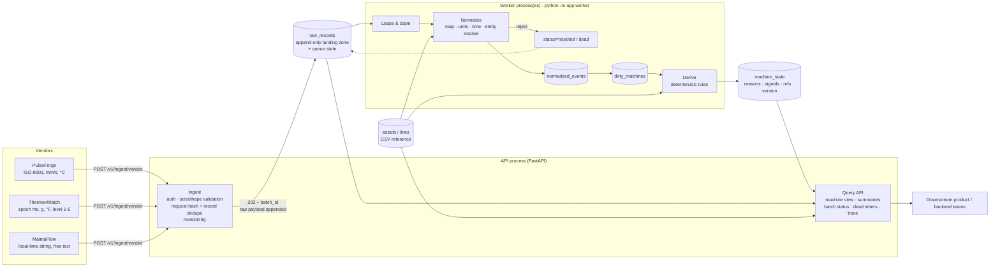

# Architecture

## Request lifecycle
1. **Accept** – validate envelope, store each record raw, dedupe, answer `202` with a `batch_id`. No normalization on the request path.
2. **Process** – worker leases pending records, normalizes, upserts the canonical event, marks the machine dirty.
3. **Derive** – the machine is recomputed from *all* its canonical events (a pure function), so ordering of arrival cannot change the result.
4. **Serve** – read models join `machine_state` with live queue counters to compute `processing_status` at read time.

## Record state machine (`raw_records.status`)
`pending → processing → processed` · `→ rejected` (permanent data error) · `→ duplicate` (same content, other id) ·
`→ superseded` (newer revision) · transient failure: `pending` again with exponential backoff → `dead` after `MAX_ATTEMPTS`.
A worker that dies mid-record leaves a lease that expires; another worker picks the record up.
