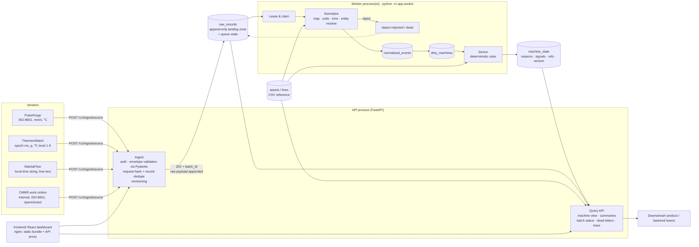

# Architecture



## Request lifecycle
1. **Accept** – validate envelope, store each record raw, dedupe, answer `202` with a `batch_id`. No normalization on the request path.
2. **Process** – worker leases pending records, normalizes, upserts the canonical event, marks the machine dirty.
3. **Derive** – the machine is recomputed from *all* its canonical events (a pure function), so ordering of arrival cannot change the result.
4. **Serve** – read models join `machine_state` with live queue counters to compute `processing_status` at read time.

## Record state machine (`raw_records.status`)
`pending → processing → processed` · `→ rejected` (permanent data error) · `→ duplicate` (same content, other id) ·
`→ superseded` with `STALE_REVISION` (an authoritative revision with a greater (vendor version, record time, arrival) key already exists) · transient failure: `pending` again with exponential backoff → `dead` after `MAX_ATTEMPTS`.
A worker that dies mid-record leaves a lease that expires; another worker picks the record up. Each claim carries a lease
token, and outcomes are written only by the current token holder, so a stalled worker cannot overwrite a newer result.
Machine recompute reads events and writes state in one transaction.

## Code layout
Two deployables in one repo: **`backend/`** (Python API + worker image) and **`frontend/`** (React app built by Vite,
served by nginx which also proxies `/v1`, `/docs` and probes to the API). They share only the HTTP contract in `docs/openapi.json`.
```
backend/app/
  main.py                 app factory: middleware (request id, access log, media type, body size), CORS, error handlers, routers
  api/deps.py             DB connection dependency, validated path/query parameter types
  api/routes/             health · ingestion · processing · machines · samples   (HTTP only, no SQL)
  schemas/                vendors.py (request envelopes)  ·  responses.py (response models, enums)  = the API contract
  services/               ingestion (store, dedupe, dry-run, batch status) · processing (DLQ, trace, reference) · views (read models)
  domain/                 vendors.py (registry) · normalization/{vocabulary,common,pulseforge,thermexwatch,maintaflow} · rules.py
  worker/                 runner.py (lease, retry/backoff, dead-letter, recompute) · __main__.py (python -m app.worker)
  db/                     schema.py (DDL) · session.py (connect, tx) · reference.py (CSV reference load)
  core/                   config · errors (one error envelope) · security (X-API-Key) · timeutil
backend/tests/            normalize · derive · api flow · reliability · validation
frontend/src/             api/ (client, types, React Query hooks) · pages/ · components/ · charts/ · features/ingest/ · lib/
frontend/                 vite.config.ts (dev proxy) · Dockerfile (node build -> nginx) · nginx.conf
```
Dependency direction: `api → services → domain`, `worker → services/domain`; `domain` has no I/O.
